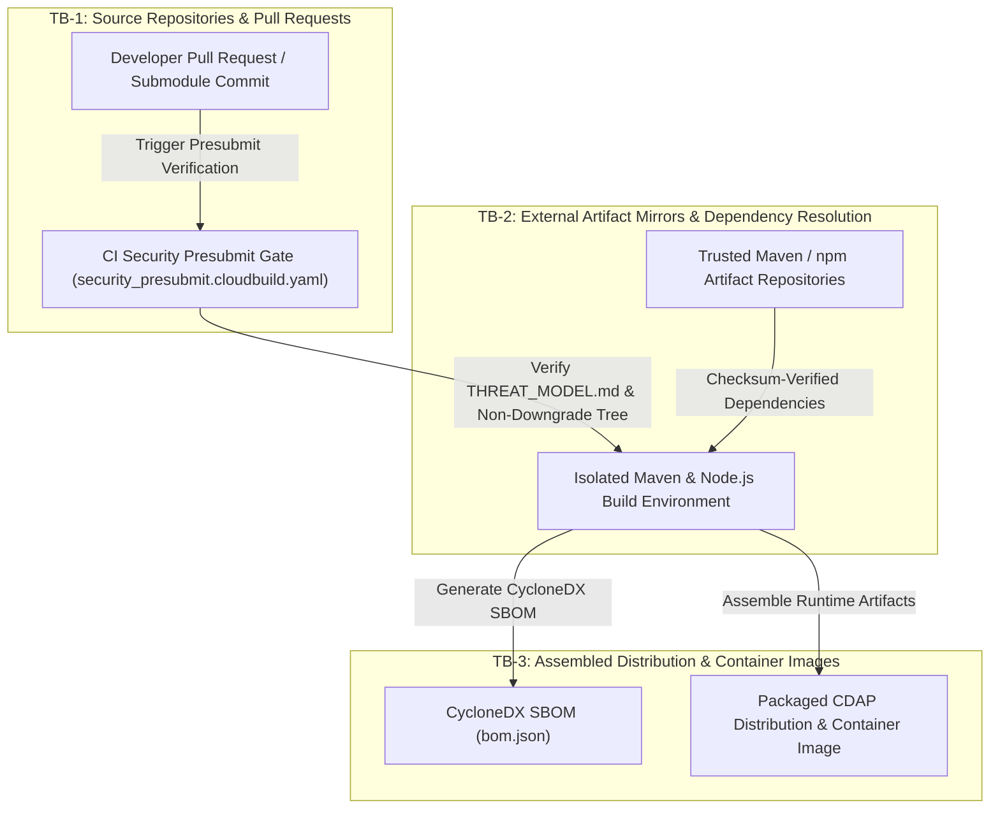

# Security Threat Model: CDAP Build, Packaging & Supply Chain (`cdapio/cdap-build`)

**Scope:** `https://github.com/cdapio/cdap-build` (branches `develop`, `release/*`)  
**Components:** Root Maven aggregator POMs, submodule orchestration, CycloneDX SBOM generation, container image packaging, and CI presubmit workflows

---

## 1. Asset Definition & Scope

This threat model defines the trust boundaries, untrusted inputs, build identities, known sink classes, and security invariants for **CDAP Build** (`cdapio/cdap-build`), which orchestrates multi-repository Maven builds, dependency management, Software Bill of Materials (SBOM) generation, and distribution packaging across the CDAP ecosystem (`cdap`, `cdap-ui`, `wrangler`, `hydrator-plugins`, and connector repositories).

- **Multi-Module Maven Aggregator & Dependency Management (`pom.xml`)**:
  - Coordinates build order, shared plugin versions, Maven repository definitions, and CycloneDX SBOM generation across CDAP submodules.
- **Packaging, Assembly & Container Build Scripts (`Dockerfile`, cloudbuild / CI configs)**:
  - Assembles compiled system artifacts (`/opt/cdap/master/artifacts/`), UI static bundles, and runtime JARs into release archives and container images.
- **Continuous Security Presubmit Gate (`security_presubmit.cloudbuild.yaml`)**:
  - Verifies component `THREAT_MODEL.md` presence, enforces non-downgrade dependency trees (`mvn dependency:tree`), and generates CycloneDX SBOM manifests (`target/bom.json`).

---

## 2. Trust Boundaries & Build Identities

### 2.1 Trust Boundaries

- **TB-1 (Source Pull Requests -> CI Build Environment Boundary)**:
  - Untrusted Pull Requests and submodule updates must be validated in an isolated build environment without access to production release signing keys or long-lived deployment credentials.
  - Build scripts must never interpolate untrusted branch names, PR titles, or commit messages into shell commands (`sh -c`).
- **TB-2 (External Artifact Repositories -> Dependency Resolution Boundary)**:
  - All Maven (`pom.xml`) and npm (`package-lock.json`) dependencies must be resolved over HTTPS from trusted repositories, avoiding snapshot or unpinned floating ranges in release branches.
  - Container image layers (`Dockerfile`) must never overwrite or downgrade newer JARs compiled in the base distribution with older hardcoded versions (`wget` / `curl` of legacy JARs).
- **TB-3 (Build Environment -> Release Artifacts & SBOM Boundary)**:
  - Every release build must emit a complete CycloneDX SBOM (`bom.json`) covering all transitive Maven and npm dependencies so downstream vulnerability scanners can audit every shipped library.

---

## 3. Untrusted Inputs & Entry Points

| Entry Point | Files / Scripts | Untrusted / External Inputs | Required Validation & Guards |
|---|---|---|---|
| **Maven Repository & Dependency Declarations** | `pom.xml`, submodule `pom.xml` files | Third-party Maven coordinates, transitive dependencies, repository URLs | Enforce HTTPS-only repositories; ban known vulnerable transitive dependencies via `maven-enforcer-plugin`; generate CycloneDX SBOMs. |
| **CI / Cloud Build Presubmit Workflows** | `security_presubmit.cloudbuild.yaml`, `.github/workflows/*` | PR diffs, branch names, commit metadata, build arguments | Avoid shell command interpolation of Git metadata; run with least-privilege build service accounts. |
| **Container Image & Archive Assembly** | `Dockerfile`, assembly descriptors, packaging scripts | Base OS packages (`apt-get`), downloaded utility binaries/JARs | Verify SHA-256 checksums on any downloaded binary/JAR; never downgrade libraries already present in `/opt/cdap/`. |

---

## 4. Known Sink Classes & Vulnerability Patterns in Scope

1. **Silent Dependency Downgrades in Multi-Stage Container Builds**:
   - **Pattern**: Downloading a hardcoded older JAR version (e.g. via `wget` or `COPY`) into `/opt/cdap/master/lib/` or `/opt/cdap/sandbox/` after the Maven build has already packaged a newer patched version.
   - **Mitigation**: Resolve all Java dependencies through Maven (`pom.xml`) and verify with `mvn dependency:tree` that no duplicate or downgraded JARs exist in the assembled image.
2. **Command Injection in CI / Build Scripts**:
   - **Pattern**: Passing `${_PR_TITLE}`, `${_HEAD_REF}`, or commit messages directly into `bash -c` scripts in Cloud Build or GitHub Actions workflows.
   - **Mitigation**: Pass untrusted values exclusively via environment variables and quote all variable expansions.
3. **Unpinned or HTTP-Only Maven Repositories**:
   - **Pattern**: Declaring `http://` repositories or dynamic `[1.0,)` version ranges in `pom.xml`, enabling MITM or dependency confusion attacks.
   - **Mitigation**: Require HTTPS for all `<repository>` and `<pluginRepository>` entries and lock release dependency versions.

---

## 5. Core Security Invariants

1. **Invariant BLD-INV-01 (No Silent Library Downgrades)**: Packaging scripts and `Dockerfile` instructions MUST NOT overwrite or coexist with newer Maven-built JARs using older downloaded versions.
2. **Invariant BLD-INV-02 (Complete CycloneDX SBOM Coverage)**: The root build (`cdap-build/pom.xml`) MUST support generating aggregate CycloneDX SBOM manifests (`cyclonedx:makeAggregateBom`) covering all packaged modules.
3. **Invariant BLD-INV-03 (Threat Model & Non-Downgrade Presubmit Verification)**: CI presubmit checks (`security_presubmit.cloudbuild.yaml`) MUST verify the presence of `THREAT_MODEL.md` and validate the dependency tree on every Pull Request.
